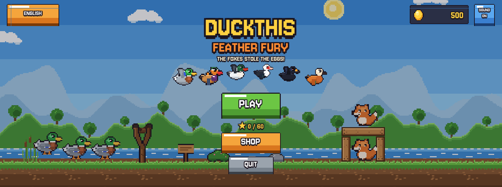
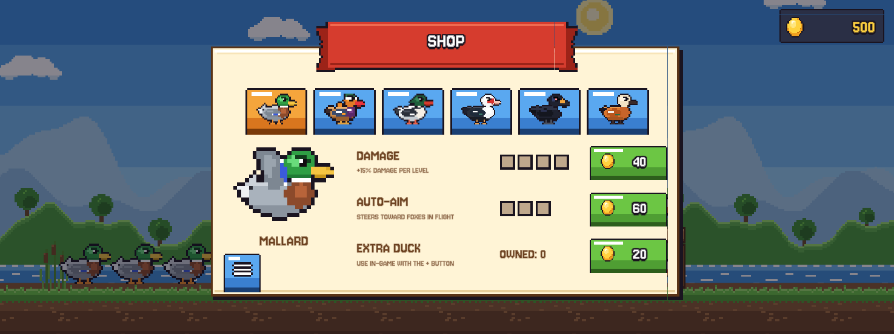
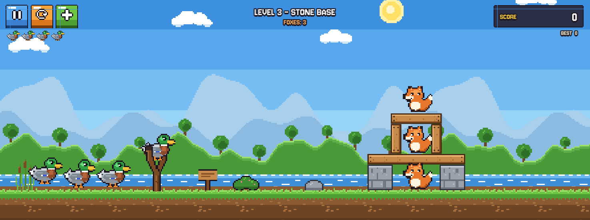

<p align="center">
  
</p>

<h1 align="center">DuckThis Feather Fury</h1>

<p align="center">
  A pixel-art physics slingshot game for Android, starring six kinds of ducks.<br>
  The foxes stole the eggs. Time to take them back.
</p>

<p align="center">
  
  
  
  
</p>

---

## About

**DuckThis Feather Fury** is a 2D physics game in the spirit of classic slingshot games. Pull back the
slingshot, launch a duck, and knock down the foxes' wood, stone and ice forts. Every duck species has
its own in-flight ability, and the Golden Eggs you earn can be spent on upgrades in the shop.

Developed by **DuckThisGames**.

## Features

- **20 levels across 4 worlds**: Lakeside, Autumn Forest, Snowy Peaks and Sunset Farm, each with its
  own theme and transitions.
- **6 duck species**, each with an ability you trigger by tapping mid-flight:

  | Duck | Ability | Strong against |
  |------|---------|----------------|
  | Mallard | Flaps upward, up to twice | – |
  | Mandarin Duck | Splits into three | Ice |
  | Merganser | Arrow-like dive | Wood |
  | Muscovy Duck | Heavy ground pound | Stone |
  | Ruddy Shelduck | Drops an egg bomb and shoots back up | – |
  | Black Scoter | Explodes | Everything |

- **Golden Egg economy**: earn eggs at the end of each level based on your stars and how much you destroyed.
- **Shop**, with three things to buy for each duck:
  - **Damage**: 4 levels, +15% per level.
  - **Auto-Aim**: 3 levels; the duck gently homes in on the nearest fox while flying.
  - **Extra ducks**: add one to the queue mid-level with the **+** button, or continue after losing.
- **Gradual difficulty**: foxes and blocks get tougher as you progress.
- **Enemies**: kit, regular, helmeted and boss foxes. Destructible wood, stone, ice, TNT crates and boulders.
- **7 languages**: Turkish, English, German, Spanish, French, Portuguese and Italian.
- Hand-made 16 px pixel art, chiptune sound effects, and saved progress.

## Screenshots

| Splash | Shop |
|---|---|
|  |  |
| **In game** | **Add a duck** |
|  |  |

## Getting started

### Requirements

- **Unity 6000.6.6f1**, with the **Android Build Support** module (OpenJDK, Android SDK & NDK).

### Open the project

```bash
git clone https://github.com/Duck-This-Games/DuckThisFeatherFury.git
```

1. Open the folder in Unity Hub with **Add project from disk**.
2. On first load the editor script (`Assets/Editor/GameBuilder.cs`) automatically configures sprite
   imports, generates the `GameArt` asset and the `Game` scene, and applies the player settings.
3. Open `Assets/Scenes/Game.unity` and press **Play**.

### Build the Android APK

Use the menu **Ördek Oyunu → Android APK Al**. It builds IL2CPP / ARM64 to `Builds/DuckThis_FeatherFury.apk`.

### Editor menu ("Ördek Oyunu")

| Command | Description |
|---------|-------------|
| Oyunu Yeniden Kur | Rebuild imports, art asset, scene and player settings |
| Bölümleri Otomatik Test Et | Run the automated level tester (writes `Logs/autotest.txt`) |
| Tüm Bölümlerin Kilidini Aç | Unlock all levels |
| İlerlemeyi Sıfırla | Reset progress, eggs and upgrades |
| Android APK Al | Build the Android APK |

## Project structure

```
Assets/
├── Art/
│   ├── Pixel/      # all pixel-art sprites (16 px = 1 unit)
│   ├── Sounds/     # chiptune sound effects
│   └── Fonts/      # Jersey 10
├── Editor/
│   └── GameBuilder.cs   # one-click setup, editor menu, APK build
├── Resources/
│   └── GameArt.asset    # sprite / sound references (generated)
├── Scenes/
│   └── Game.unity       # single scene; levels are built at runtime
└── Scripts/
    ├── GameManager.cs   # game flow: splash, menu, levels, win/lose
    ├── Hud.cs           # pixel-art IMGUI interface, shop, transitions
    ├── Economy.cs       # Golden Eggs, upgrades, extra ducks
    ├── Bird.cs          # duck physics, abilities, auto-aim
    ├── BirdType.cs      # duck stats and material multipliers
    ├── Fox.cs           # enemies
    ├── Destructible.cs  # damage model for blocks and foxes
    ├── Levels.cs        # the 20 level layouts
    ├── LevelLoader.cs   # builds levels and themes, difficulty scaling
    ├── Loc.cs           # localization (7 languages)
    └── ...              # Slingshot, CameraRig, Fx, Sfx, Explosion, EggBomb, AutoTester
```

### Adding a level

Levels are defined in code in `Assets/Scripts/Levels.cs` with small helpers:
`Frame`, `Beam`, `Col`, `Cube`, `Tnt`, `Boulder` and `Fox(kind, x, y)`.

## Türkçe

**DuckThis Feather Fury** is a pixel-art, physics-based slingshot game for Android starring ducks.
You take on the foxes' forts in 20 levels with 6 duck species, each with its own ability.

At the end of each level you earn **Golden Eggs** based on your stars and destruction. In the shop you
can spend them on damage upgrades, auto-aim, and extra ducks for each species.

To open the project, use Unity 6000.6.6f1 and add the folder in Unity Hub. On first load everything
is set up automatically.

---

<p align="center">© DuckThisGames</p>
